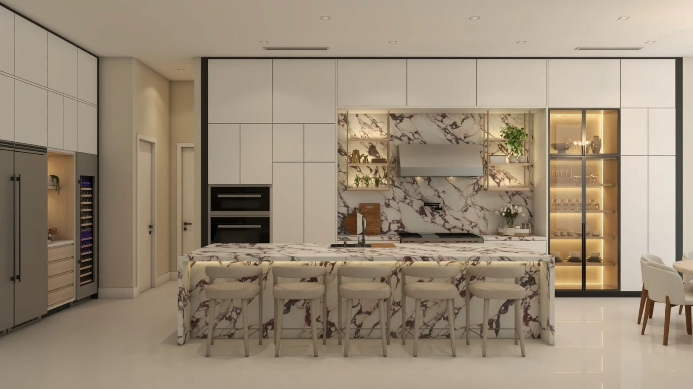

If your Miami condo is ready for furniture, you may not need a renovation to make it feel like home. Our [Design Express service](/design-express-miami/) brings furniture planning, purchasing, installation and styling together. Eligible homes can be ready in as little as 40 days. We confirm timing after we review the property, scope, building requirements and availability.

## When Design Express makes sense

Design Express is a good fit when the layout and major finishes are staying in place. It works for a new condo, a second home or a residence you want furnished without making every selection yourself. If the project needs a gut renovation, new cabinetry throughout or pieces with long fabrication times, our [full service turnkey design](/turnkey-interior-design-miami/) is usually a better fit.

## What happens before installation

1. **Confirm the scope.** We review your plans, room dimensions, priorities and the date you need the home ready.
2. **Choose furniture as a whole.** We show how seating, dining, lighting and rugs will work together before anything is ordered.
3. **Check the building and the lead times.** We account for access, delivery hours, elevator reservations and the availability of each item.
4. **Coordinate delivery and styling.** Our team manages the agreed delivery and installation scope, then walks through the finished rooms with you.

## Can we start before closing?

Yes. If you can share a floor plan and the building's rules, we can start planning before you receive the keys. We still need to verify measurements, access and the installation schedule before committing to a date.

[Start your Miami condo furnishing project](/contact/) and tell us when you plan to move in.

