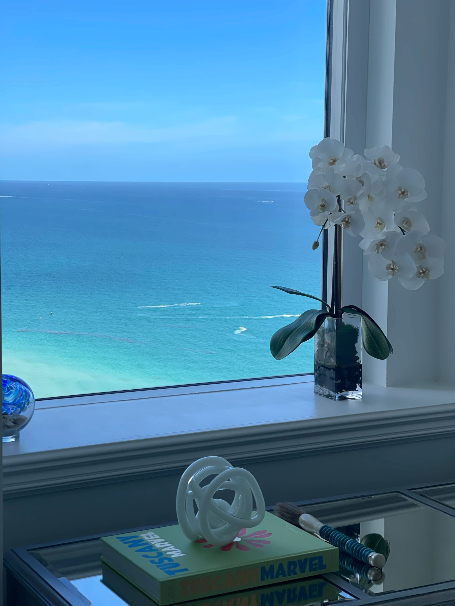
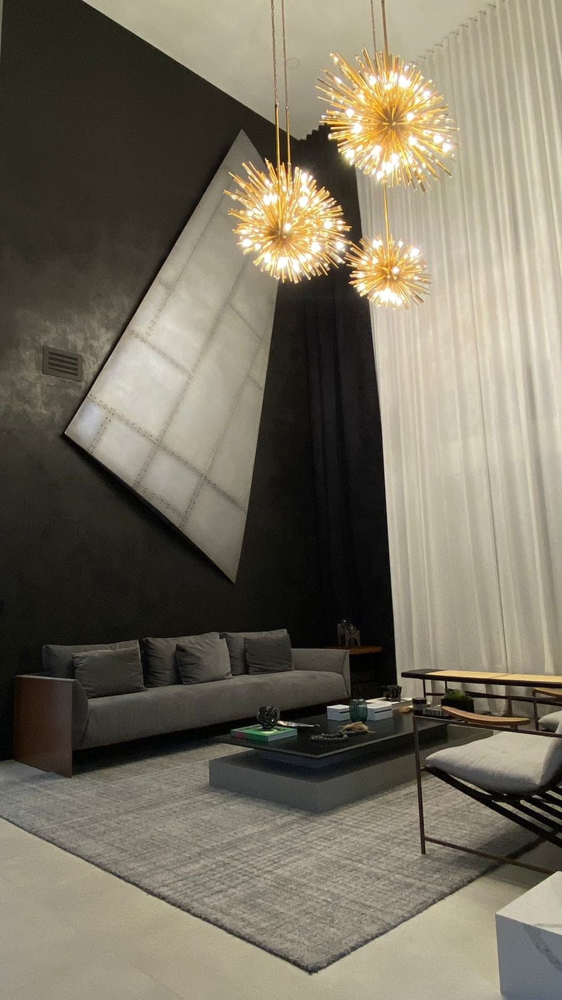
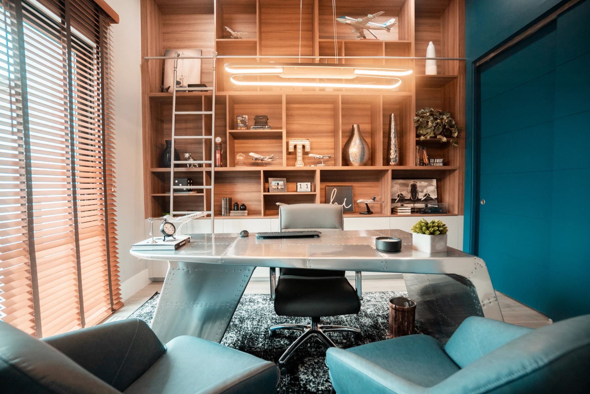
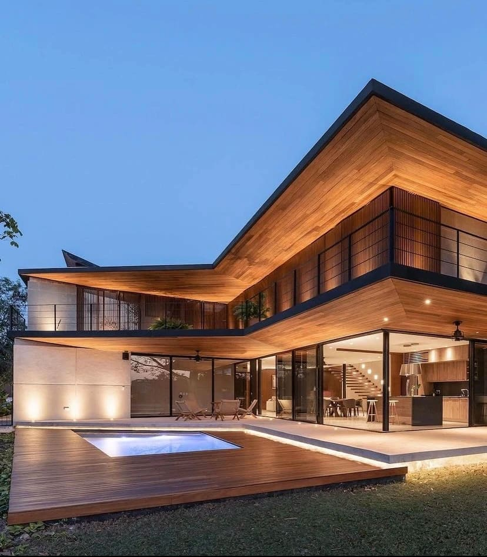
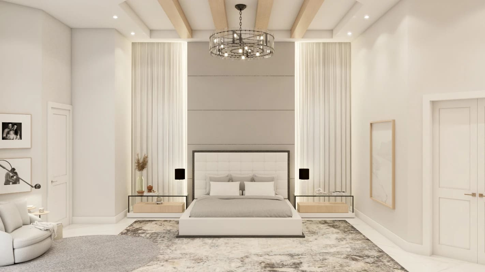

When people think about interior design, many still see it as an expense.

But in reality, especially in markets like Miami, Brickell, Miami Beach, Sunny Isles, Bal Harbour, Coral Gables and Boca Raton, high-end interior design is one of the most strategic investments you can make.

Design is not about decoration.

It is about deciding what will improve everyday life before committing to purchases.

## Make the Layout Easy to Understand

A well-designed home is perceived differently from the first moment.

Buyers don’t analyze every detail logically. They feel the space. They respond to light, materials, flow and atmosphere.

In a Brickell or Miami Beach condo, leave a clear path from the entry to the seating area and windows. Furniture should help explain the layout, not cover it up.

## Show the Home Clearly in Photos

In markets like Sunny Isles Beach and Bal Harbour, where buyers are international and visually driven, first impressions happen online.

Take enough photos to show how the rooms connect, not just close ups of materials. Sale price and timing depend on pricing, condition and market demand.

## Avoiding Costly Mistakes

One of the biggest hidden costs in any project is rework.

Wrong materials, poor lighting decisions, incorrect layouts or trend-driven choices can lead to expensive corrections. These are mistakes that often happen when design is not guided professionally.

A designer can flag these issues while the scope is still on paper.

Design is not an added cost.

It is cost control.

## Strategic Material Selection

High-end design is built on materials.

Natural stone, custom millwork, layered lighting and timeless finishes create durability and elegance. Choose versions that suit the wear and maintenance each room will see.

In Coral Gables and Boca Raton, where homes are long-term investments, material selection plays a critical role in how a property performs years later.

Cheap choices cost more in the long run.

## Lifestyle Value: The Experience of Living

Beyond financial return, interior design transforms daily life.

A well-designed home supports routines, creates calm and enhances comfort. Lighting adapts to the day. Spaces flow naturally. Materials feel right.

In Miami, where lifestyle is everything, this experience becomes part of the home’s value.

Luxury today is not excess.

It is how a space makes you feel.

## Design as a Competitive Advantage

In a saturated market, differentiation is everything.

A property without design blends in. A property with design stands out.

In areas like Brickell, Miami Beach and Sunny Isles, where buyers have many options, interior design becomes the deciding factor.

Design is not just about beauty.

It is about positioning.

## Working With a Professional Changes Everything

Hiring an interior designer brings clarity, structure and vision.

From concept to execution, every decision becomes intentional. Materials align. Lighting is layered. Spaces feel complete.

The result is a plan that connects the layout, finishes and furnishings.

This is where design becomes investment.

## Final Thought

High-end interior design is not about spending more.

It is about investing smarter.

Start with the rooms you use every day, and decide which changes the existing home actually needs.

