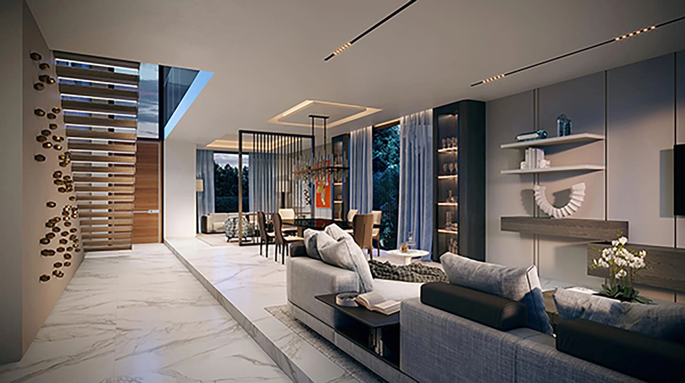
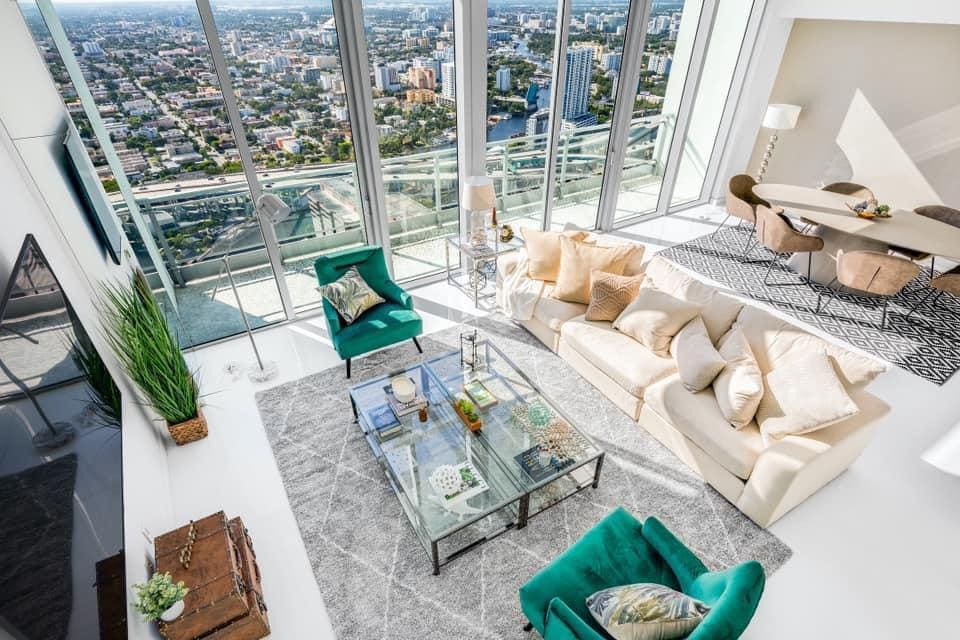
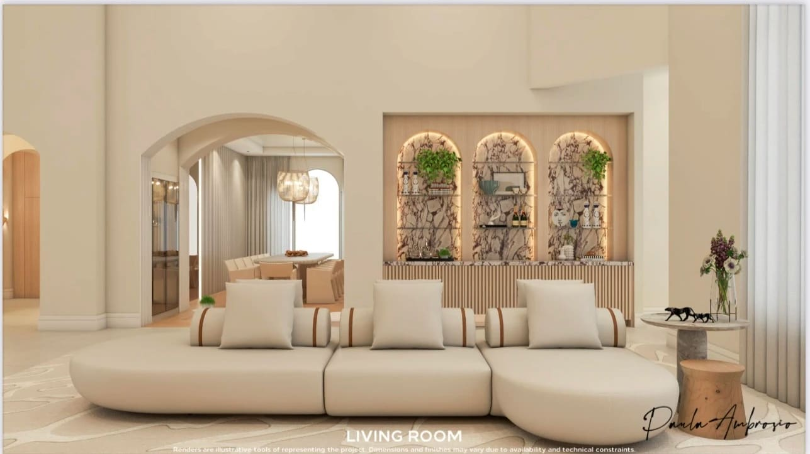
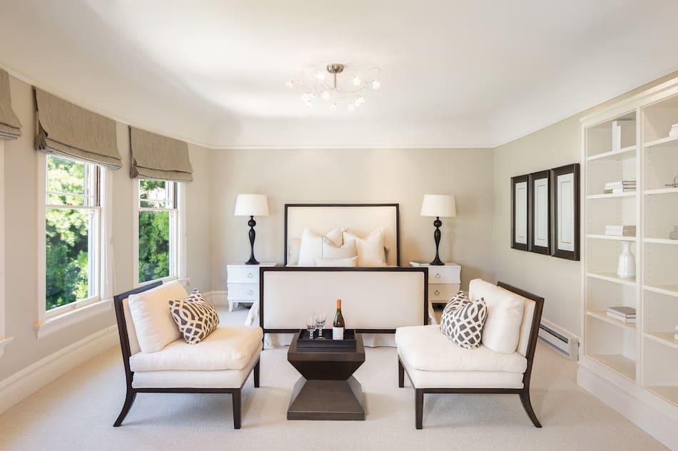
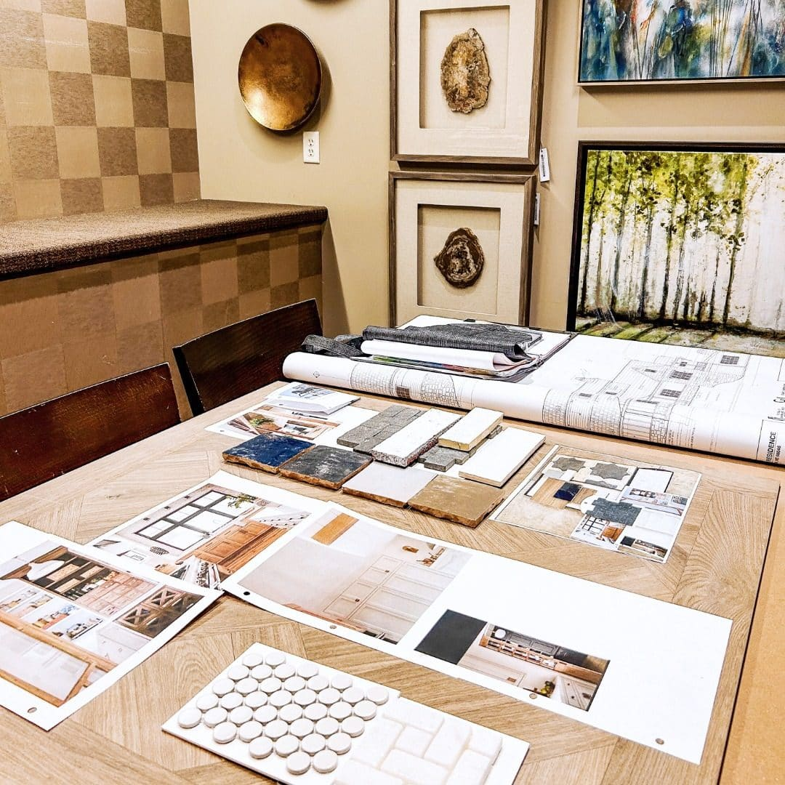

Before setting a renovation budget for a Miami investment property, decide which work the unit needs and which materials can stay. Involve the designer and contractor early if the plan depends on layout changes.

## Design Is No Longer About Taste, It Is About Strategy

Today’s investors are not just buying square footage. They are buying experience, perception and positioning.

A design team can turn an owner’s priorities into a floor plan, material palette and furnishing scope.

Start by showing how the unit works: where guests enter, how the living room seats people and which storage belongs in each room.

## How a Design Team Changes the Game for Investors

When investors work with a professional interior design team, the process becomes clear and controlled.

The designer leads material selection based on durability and market appeal. Space planning is optimized for functionality and lifestyle. Finishes are chosen to align with buyer expectations in each location. Lighting, wall treatments and furniture are layered to enhance perception without unnecessary cost.

This gives the owner and contractor a common plan to review before committing to the work.

Design becomes part of the financial strategy.

## Understanding Local Markets Makes All the Difference

Miami is not one single market. Each city has its own rhythm, buyer profile and design language.

### Brickell

Urban investors in Brickell demand modern layouts, efficient spaces and a polished metropolitan feel. Design here must be sleek, intelligent and globally appealing.

### Sunny Isles Beach

In Sunny Isles, international buyers expect resort style living. Design focuses on light, flow, comfort and a luxury vacation mindset that still feels refined.

### Coral Gables

Heritage and architecture guide design choices. Respecting structure while updating interiors for modern living is essential.

### Boca Raton

Timeless elegance and long term value define the market. Design decisions prioritize longevity, quality materials and understated sophistication.

These examples are starting points. The building, floor plan and intended use should guide the choices.

## Make Property Photos Useful

Show how the living and dining rooms connect, and include the entry and storage where those details affect daily use. Design can make the layout easier to understand. Sale price and timing depend on pricing, condition and demand.

## Why Investors Should Think in Teams, Not Vendors

Winning projects are not built by isolated decisions. They are built by teams.

When interior designers collaborate with architects, developers, contractors and brokers, the project gains alignment. Budget is respected. Timelines are clearer. Design supports the business plan, not the other way around.

This is where experienced interior designers bring the most value. They understand both the creative and financial language of a project.

## Final Thought

Before the first purchase, agree on a floor plan, a list of what stays and which approvals the building needs. Those decisions are easier to change on paper than after installation.

