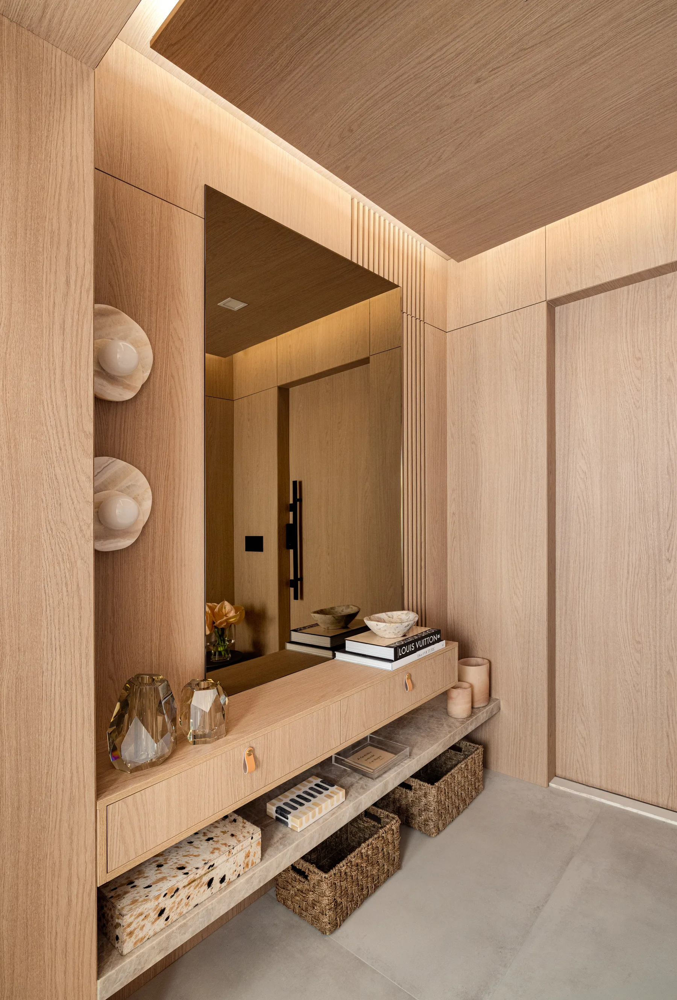
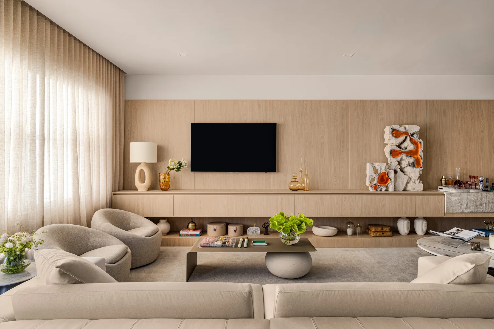
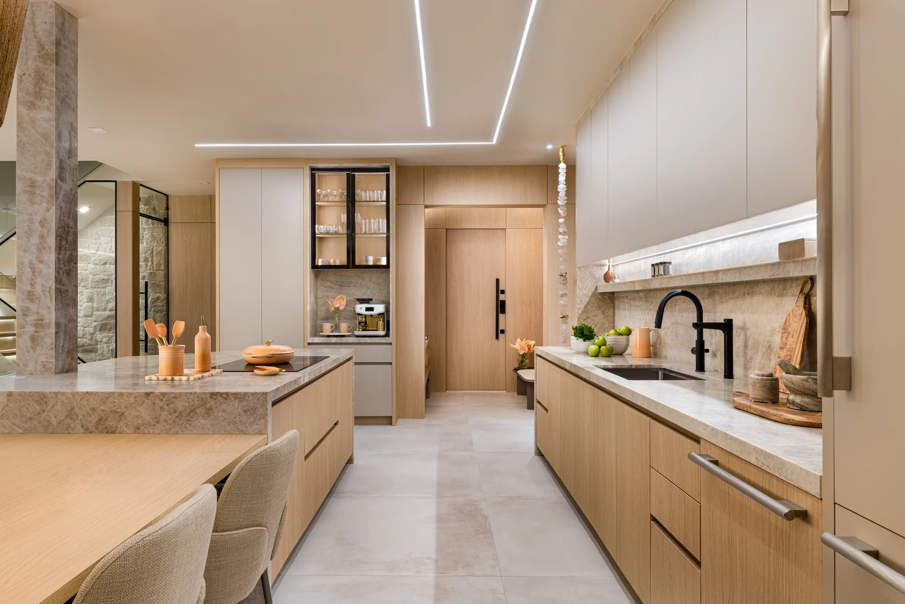

Contemporary rooms can feel disconnected when every room starts with a new finish. In this [North Miami residence](/projects/home-aa/), we used a common palette and continuous millwork to give the entry, living room and kitchen a sense of continuity. Photography by Gabriel Matarazzo / GABBA Visuals.

## Start at the entry

The entry needed somewhere to set down everyday objects without interrupting the path into the house. A console raised off the floor keeps the passage open. The large mirror reflects surrounding light and lets the recessed area feel like part of the architecture, not a piece of furniture dropped into a hallway.

## Give the living room more than one focus

The media wall could easily have dominated the room. Instead, we gave its lower ledge room for art and objects and used a consistent oak surface to keep the composition quiet. Sheer curtains soften the light as it changes throughout the day. Rounded seating softens the long lines without fighting the architecture.

The ledge makes room for objects the owners want to see and helps keep the television from becoming the only focal point. That is a useful principle in rooms that need to work for quiet evenings and for guests.

## Use a familiar material in a new way

The kitchen continues the palette but gives veined stone a stronger role. The island anchors the room, and integrated task lighting makes the work surface easier to use. At the bar, stone becomes a sculptural element. Warm lighting makes its texture more legible after dark.

A dedicated coffee station keeps an everyday routine close at hand rather than turning the main work surface into storage. Bringing that brief into the cabinetry design early made room for both the display and the things better kept out of sight.

## What to borrow for your own home

Decide what should repeat before you decide what should stand out. A wood tone, a light temperature or a finish can connect several spaces. Then give each room one detail that serves its own routine. It is easier to choose furniture and lighting when you know which material will carry the design from room to room.

For more examples, explore our [custom millwork service](/millwork/), see [kitchen design ideas](/spaces/kitchen/) or [talk to our North Miami studio](/contact/).
