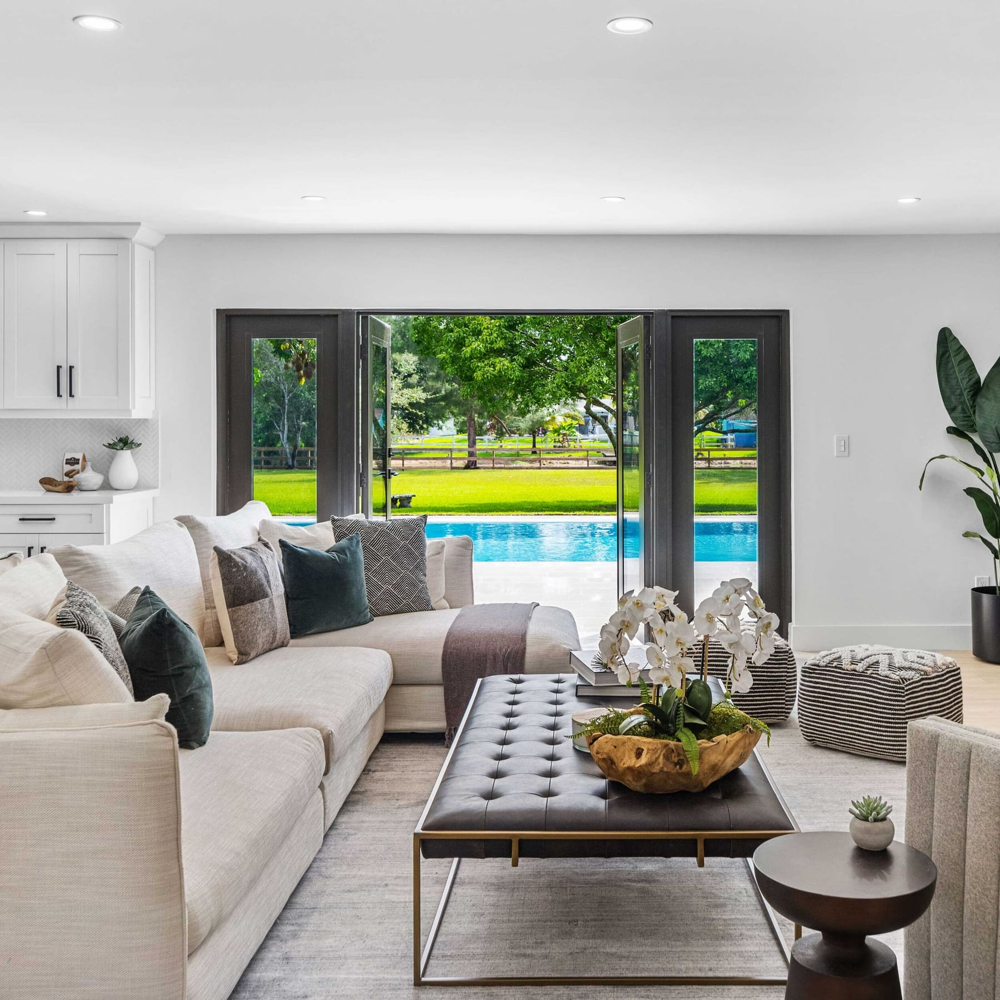
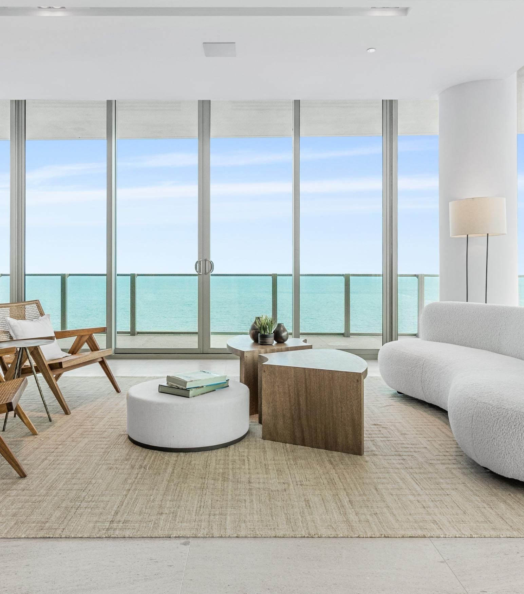
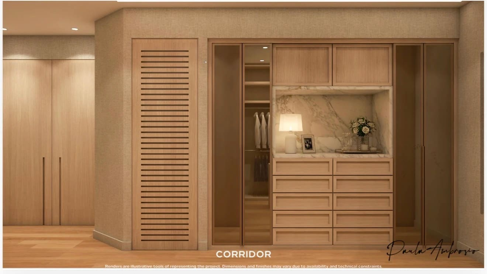
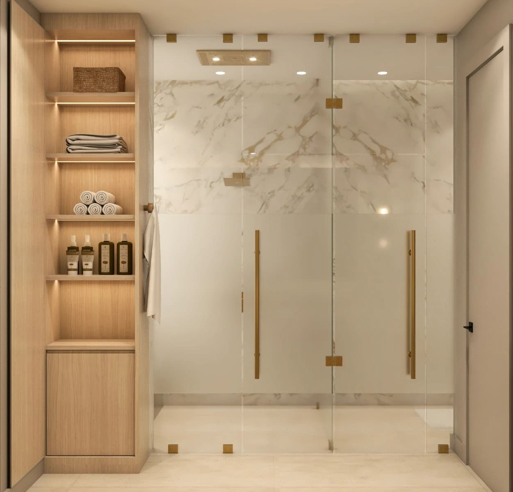
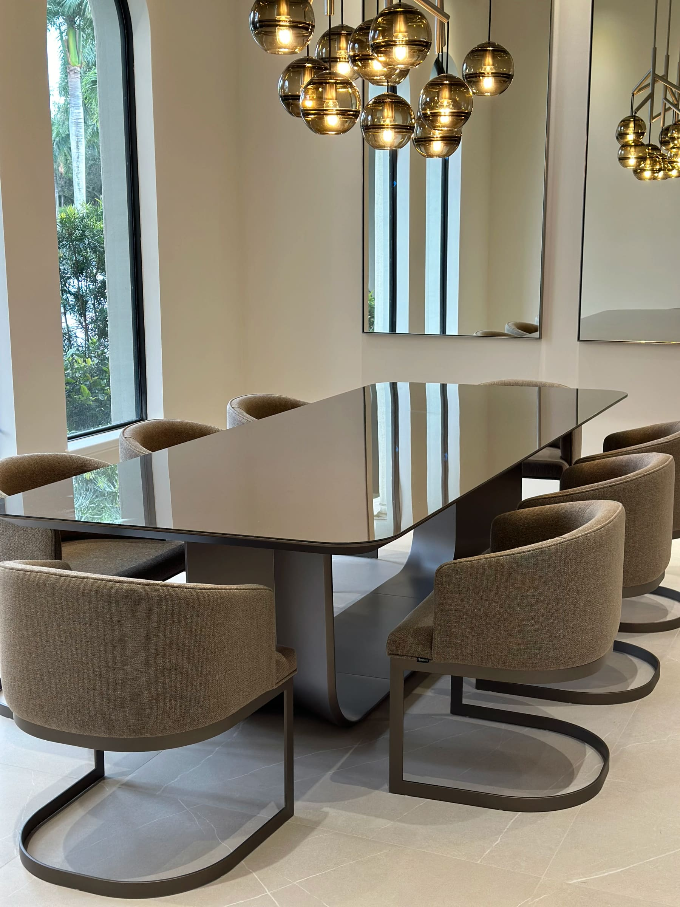
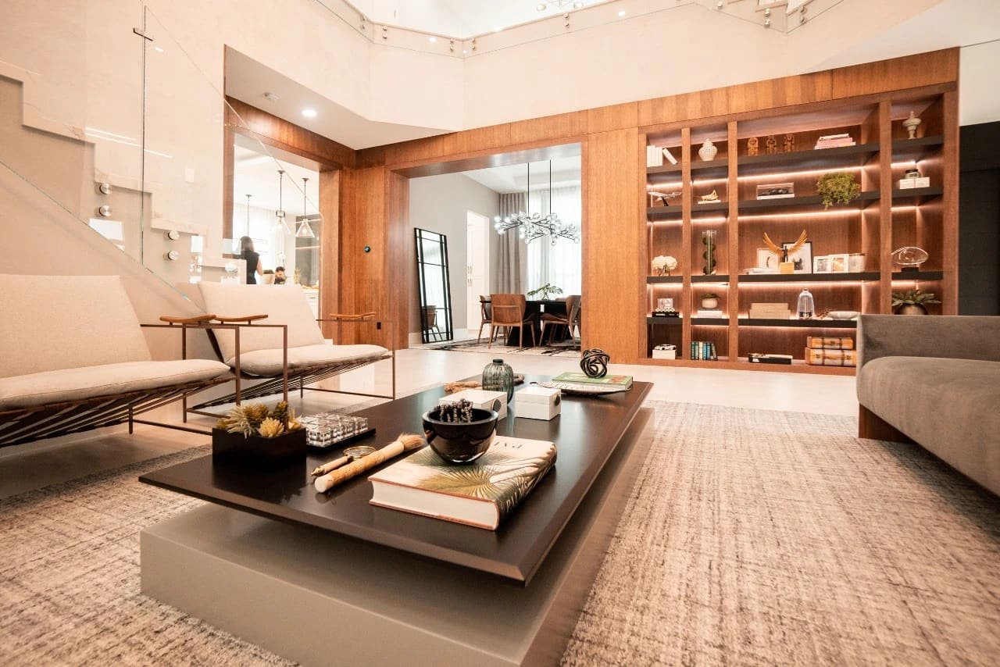

When you buy or update a property in Miami, the useful design question is not how much you can change. It is which changes make the home easier to use, and which ones you can skip. Start with a walk through the property before setting the renovation budget.

## Decide what needs work before choosing finishes

Check where people enter, how they get from the kitchen to the dining room and whether the bedrooms have usable storage. Keep sound finishes and fixtures if they support the plan. Address layout problems before spending on surface upgrades, especially when opening a wall or relocating plumbing would change the scope.

## Plan for the property, not a generic buyer

In a Brickell condo, check that the dining area can seat guests without blocking access to the balcony. In a Coral Gables family home, look at where bags, shoes and everyday supplies will go. In a waterfront condo, place furniture where people can sit comfortably and still enjoy the view. These are different design problems, even when the rooms have similar dimensions.

## Account for condo rules before ordering

Ask building management about approvals, delivery windows, elevator reservations and restrictions on flooring or trades. Verify the path from the loading dock to the unit before ordering large pieces. Read our guide to [condo renovation and interior design in Miami](/condo-renovation-interior-design-miami/) for more on preparing the scope.

## Know what design can and cannot do

A clear floor plan, usable storage and good lighting can help buyers understand how a property works. Design cannot guarantee offers, a sale price or a closing date. Pricing, property condition and market demand matter, so coordinate any decision to renovate for resale with your real estate advisor.

[Talk with our studio](/contact/) about what to keep, where to invest in design and what to decide before work begins.

