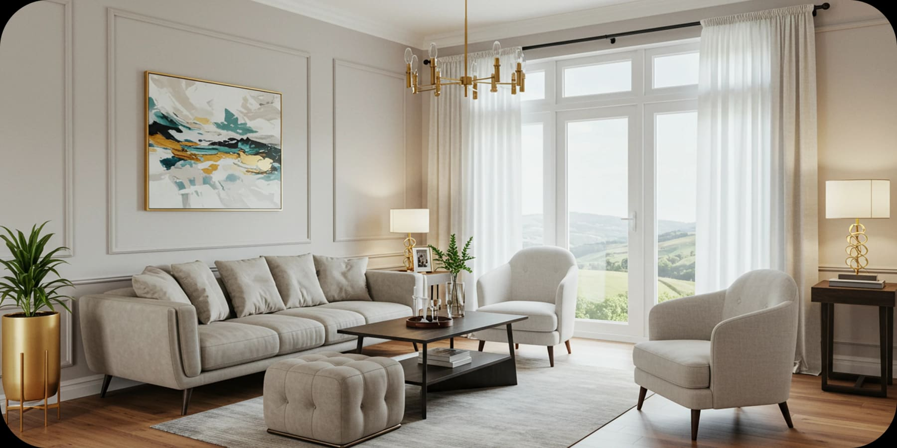
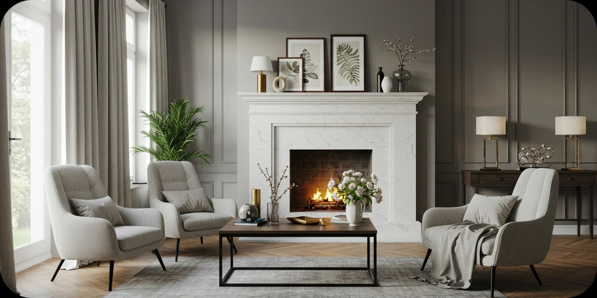
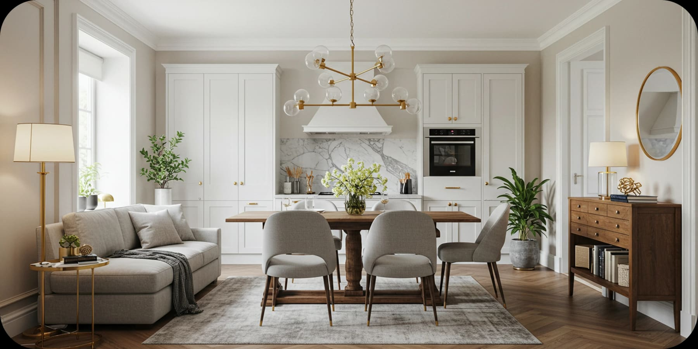

Buyers see the square footage in a listing. What is harder to see is how that space might work on an ordinary day. A seating plan, good lighting and a clear path through the rooms can answer questions that photos of empty rooms leave open.

## Three changes that make a room easier to read

1. **Show the scale.** Choose a sofa and chairs that leave room to walk. An open path from the entry to the windows helps buyers see how the layout works.
2. **Give each zone a purpose.** In an open plan, a rug can define the sitting area while a pendant gives the dining table its own place. The rooms can feel connected without blending together.
3. **Use light to show what is already there.** Open the window coverings for a daytime photo and add a floor or table lamp where someone would read. Let the materials and natural light do more of the work than the accessories.

## Start with what you already have

Before buying anything, try moving one piece of furniture or removing an item that blocks a view. Then walk through the home from the front door and take a photo. You may find that a simpler arrangement explains the space better than a new set of furnishings.

Interior design can help buyers picture using a home. Sale price and timing still depend on pricing, property condition and market demand.

[Talk with our studio](/contact/) about clarifying your layout, choosing furnishings or preparing a home for its next chapter.

